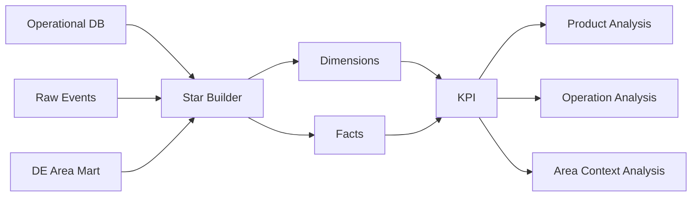

# 다시골목(dasiGolmok) — Local Story & Commercial Area Analytics

> **골목 스토리의 등록·지도 탐색·상세 조회·좋아요·공유·큐레이션·관리자 승인 흐름을 이벤트로 구조화하고, 골목상권 공공데이터 Context와 결합해 사용자 참여와 지역 콘텐츠 운영을 분석하는 Data Analytics 프로젝트**

## 1. Project Overview

다시골목은 지역과 장소를 기반으로 사용자가 골목의 스토리를 탐색하고 등록하며, 지도·큐레이션을 통해 콘텐츠를 소비하는 서비스입니다.

Data Analytics 영역에서는 단순 조회수 집계보다 다음 흐름을 분석 가능한 데이터 구조로 만드는 데 집중했습니다.

```text
Story / User Activity
        ↓
Raw Event
        ↓
Analytics Star Schema
        ↓
KPI Snapshot
        ↓
Product / Operation Analysis
        ↓
Area Context Analysis
        ↓
Decision Support
```

### DA 핵심 구성

* GA4-style 사용자 행동 Event 적재
* 사용자 ID SHA-256 비식별화
* Dimension / Fact 기반 Star Schema
* KPI Formula Version 관리
* 스토리 Lifecycle 분석
* 지도 → 상세조회 Funnel 분석
* 사용자 참여율 분석
* 큐레이션 CTR 분석
* 관리자 승인율 / 승인시간 분석
* 골목상권 공공데이터 Context Coverage 분석
* Area Context와 Engagement 연관성 분석
* KPI Snapshot + JSON Report 생성 Pipeline
* Materialized View 비동기 Refresh 최적화

---

# 2. Business Problem

지역 콘텐츠 서비스에서는 단순히 스토리가 몇 개 등록되었는지만으로 서비스 상태를 판단하기 어렵습니다.

다음과 같은 질문에 답할 수 있어야 합니다.

```text
스토리가 실제로 등록되고 있는가?
        ↓
사용자가 지도에서 스토리를 발견하는가?
        ↓
상세 화면까지 이동하는가?
        ↓
좋아요 / 공유 등 참여 행동으로 이어지는가?
        ↓
큐레이션이 실제 클릭으로 이어지는가?
        ↓
관리자는 콘텐츠를 얼마나 빠르게 검토하는가?
        ↓
지역 상권 Context가 연결된 콘텐츠는
어떤 사용자 행동 패턴을 보이는가?
```

따라서 다시골목 DA는 서비스의 사용자 행동, 콘텐츠 Lifecycle, 운영 프로세스, 지역 Context를 하나의 분석 구조로 연결했습니다.

---

# 3. Core Analysis Questions

## BQ-01. 어느 지역에서 스토리가 많이 등록되는가?

스토리 등록 건수를 지역 단위로 분석합니다.

```text
Region
   ↓
Story Registration
   ↓
지역별 콘텐츠 생성량
```

이를 통해 특정 지역에 콘텐츠 생성이 집중되어 있는지 확인할 수 있습니다.

---

## BQ-02. 지도 탐색은 실제 스토리 소비로 이어지는가?

다시골목의 핵심 사용자 흐름 중 하나는:

```text
Map View
    ↓
Story Detail View
```

입니다.

따라서 다음 KPI를 정의했습니다.

```text
Map → Detail Conversion
=
Map에서 진입한 Story Detail View
/
Map View
```

지도 기능이 단순 탐색 화면으로 끝나는지, 실제 콘텐츠 소비로 연결되는지를 확인하는 지표입니다.

---

## BQ-03. 사용자가 콘텐츠 생산에도 참여하는가?

서비스 방문뿐 아니라 사용자가 직접 스토리를 만드는 비율을 확인합니다.

```text
Participation Rate
=
Content Creators
/
Registered Users
```

이를 통해 다시골목이 단순 콘텐츠 소비 서비스인지, 사용자 생성 콘텐츠가 발생하는 참여형 서비스인지 분석할 수 있습니다.

---

## BQ-04. 콘텐츠가 외부 공유 행동으로 이어지는가?

다음 Event를 수집합니다.

```text
share
```

이를 이용해:

* 전체 Share Count
* 지역별 Share
* 콘텐츠별 Share
* Channel별 Share

분석으로 확장할 수 있습니다.

---

## BQ-05. 관리자 검수 과정은 효율적으로 운영되는가?

사용자가 등록한 Story는 관리자 Review 흐름을 거칩니다.

분석 지표:

```text
Approval Rate
Time To Approve
```

Approval Rate:

```text
APPROVED
/
(APPROVED + REJECTED)
```

평균 승인 시간:

```text
AVG(
  Review Decision Time
  -
  Story Created Time
)
```

이를 통해 콘텐츠 운영 병목을 분석할 수 있습니다.

---

## BQ-06. 큐레이션은 실제 상세 조회로 이어지는가?

큐레이션 노출과 클릭을 별도 Event로 분석합니다.

```text
Curation Impression
        ↓
Story Detail View
```

KPI:

```text
Curation CTR
=
Curation Click
/
Curation Impression
```

현재 분석 Grain은 `sort_type`을 포함하도록 구성했습니다.

따라서 추후:

```text
popular
latest
recommended
```

같은 큐레이션 정책별 성과 비교로 확장할 수 있습니다.

---

## BQ-07. 지역 상권 Context가 콘텐츠에 얼마나 연결되어 있는가?

승인된 Story 중 외부 Area Context와 연결된 비율을 측정합니다.

```text
Area Context Coverage
=
Approved Stories With Area Context
/
Total Approved Stories
```

이를 통해 상권 데이터 결합 범위를 확인할 수 있습니다.

---

## BQ-08. Area Context가 연결된 Story는 다른 Engagement 패턴을 보이는가?

Story를 다음 두 그룹으로 나눕니다.

```text
mapped
vs
미매핑
```

Engagement 대상 Event:

```text
Story Detail View
Like
Share
```

두 Segment의 평균 Engagement를 비교해:

```text
Area Engagement Lift
=
Avg Engagement | Area Context
/
Avg Engagement | No Area Context
```

를 계산합니다.

단, 이 결과는 **Area Context와 사용자 Engagement 사이의 연관성만 나타내며 인과관계를 의미하지 않습니다.**

---

# 4. KPI Catalog

KPI 정의를 분석 코드나 Dashboard에 직접 흩어놓지 않고 별도의 KPI Catalog와 DB Metric Version Table로 관리합니다.

| KPI                     | Formula                        | 주요 분석 목적            |
| ----------------------- | ------------------------------ | ------------------- |
| `story_registration`    | Story Count                    | 지역별 콘텐츠 생성          |
| `map_to_detail`         | Detail from Map / Map View     | 지도 탐색 전환            |
| `participation_rate`    | Creators / Users               | 사용자 콘텐츠 참여          |
| `share_count`           | Share Event Count              | 콘텐츠 확산              |
| `approval_rate`         | Approved / Decision            | 관리자 승인율             |
| `time_to_approve`       | Avg Decision Time              | 운영 처리시간             |
| `curation_ctr`          | Click / Impression             | 큐레이션 성과             |
| `area_context_coverage` | With Area / Approved           | 상권 Context Coverage |
| `area_engagement_lift`  | Engagement With / Without Area | Area Context 연관성    |

현재 Formula Version:

```text
v1
```

---

# 5. Metric Versioning

분석 지표는 시간이 지나며 정의가 변경될 수 있습니다.

예를 들어 `Participation Rate`의 분모를:

```text
전체 가입자
```

에서:

```text
최근 30일 Active User
```

로 변경한다면 이전 지표와 같은 KPI라고 보기 어렵습니다.

따라서 다음 Metadata를 저장하도록 구성했습니다.

```text
metric_key
formula_version
formula_text
grain
owner_team
updated_at
```

예:

```text
metric_key      = curation_ctr
formula_version = v1
grain           = day
owner_team      = Product
```

이를 통해 동일한 KPI라도 어떤 계산 정의를 사용했는지 추적할 수 있습니다.

---

# 6. Event Analytics

사용자 행동은 `raw_events`에 저장합니다.

주요 Event:

```text
map_view
story_detail_view
like_toggle
share
curation_impression
area_context_view
story_register
```

Event에는 분석에 필요한 Context도 함께 저장합니다.

```text
event_id
event_name
occurred_at

user_id_hash
session_id

story_id
region_id
area_code

source
channel
sort_type
position

action
has_area_context

has_image
category
zoom
```

---

# 7. Event Idempotency

동일 Event가 여러 번 적재되면 KPI가 잘못 증가할 수 있습니다.

따라서:

```text
event_id = PRIMARY KEY
```

로 관리하고 Seed Pipeline 역시:

```text
ON CONFLICT (event_id)
DO NOTHING
```

방식으로 재실행 가능한 구조를 사용합니다.

분석 Pipeline을 다시 실행해도 동일 Event가 중복으로 증가하지 않도록 구성했습니다.

---

# 8. Analytics Star Schema

운영 DB의 Story·User·Region 데이터를 매 분석 쿼리마다 직접 결합하지 않고 별도의 분석 모델을 구성했습니다.



---

# 9. Dimensions

현재 분석 모델에는 다음 Dimension이 있습니다.

| Dimension    | 역할              |
| ------------ | --------------- |
| `dim_date`   | 날짜 / 주 / 월 / 분기 |
| `dim_region` | 지역              |
| `dim_place`  | 장소              |
| `dim_user`   | 비식별 사용자         |
| `dim_tag`    | 테마 / 기간 Tag     |
| `dim_status` | Story 상태        |
| `dim_area`   | 골목상권 Context    |

총 **7개 Dimension**을 기준으로 분석 Fact를 Segment할 수 있도록 구성했습니다.

---

# 10. Fact Tables

## `fact_story_lifecycle`

Grain:

> **Story 1건**

주요 데이터:

```text
story_id

region
place
user
status
area

register_date
approve_date

has_area_context
like_count

category
period_tag

created_at
approved_at
```

활용:

* 지역별 Story 등록
* 승인 Story 수
* Creator 분석
* 콘텐츠 Category 분석
* Area Context Coverage

---

## `fact_user_engagement`

Grain:

> **사용자 행동 Event 1건**

주요 데이터:

```text
event_name
date
region
story
user
area

has_area_context

source
channel
sort_type

occurred_at
```

활용:

* Map → Detail
* Like
* Share
* Curation CTR
* Area Context Engagement

---

## `fact_admin_review`

Grain:

> **관리자 Review 1건**

주요 데이터:

```text
story_id

before_status
after_status

reviewer
hours_to_decision
occurred_at
```

활용:

* Approval Rate
* Rejection Rate
* Time To Approve
* 운영 처리시간 분석

---

## `fact_area_context_snapshot`

Grain:

> **Area × 기준시점 Snapshot**

주요 데이터:

```text
area_code
base_period

store_count_total
open_rate_avg
close_rate_avg

monthly_sales_total
sales_is_estimate

source_name
source_url
license_type

fetched_at
area_mapping_version
```

서비스 내부 Story 데이터와 외부 상권 데이터를 직접 섞어 원본처럼 취급하지 않고 별도의 **Context Fact**로 유지합니다.

---

# 11. KPI Snapshot

최종 KPI는:

```text
da_kpi_snapshot
```

에 저장합니다.

구조:

```text
metric_key
grain_label
segment_json

metric_value
numerator
denominator

formula_version

computed_at
pipeline_run_id
notes
```

이를 통해 단순히 최종 숫자 하나만 저장하는 것이 아니라:

```text
어떤 KPI인가?
어떤 Segment인가?
분자는 무엇인가?
분모는 무엇인가?
어떤 Formula Version인가?
어떤 Pipeline 실행에서 생성되었는가?
```

까지 추적할 수 있습니다.

---

# 12. Area Context Analysis

다시골목 DA의 특징 중 하나는 서비스 내부 행동 데이터와 골목상권 Context를 연결한다는 점입니다.

기본 흐름:

```text
Story
  ↓
Place
  ↓
Place ↔ Area Mapping
  ↓
Commercial Area
  ↓
Area Context Snapshot
```

분석에 사용할 수 있는 Context:

```text
점포 수
평균 개업률
평균 폐업률
월 매출
기준 분기
데이터 출처
라이선스
```

---

# 13. Story Density × Commercial Area Context

승인된 Story를 Area 단위로 집계하고 외부 상권 Context와 연결합니다.

분석 구조:

```text
Area
 ├─ Approved Story Count
 ├─ Store Count
 ├─ Open Rate
 ├─ Close Rate
 └─ Base Period
```

이를 이용하면:

> Story가 많이 등록되는 골목과 상권의 점포·개폐업 지표 사이에 어떤 패턴이 관찰되는가?

와 같은 질문을 탐색할 수 있습니다.

단,

```text
Story Density ↑
+
Commercial Activity ↑
```

가 함께 관찰되더라도:

> Story가 많아서 상권이 활성화되었다

또는

> 상권이 활성화되어 Story가 증가했다

라고 인과관계를 단정하지 않습니다.

현재 분석 범위는 **association / correlation 탐색**입니다.

---

# 14. Data Attribution

외부 공공데이터를 분석 결과에 사용할 경우 데이터 출처와 기준시점을 함께 남깁니다.

Area Report에는 다음 정보가 포함됩니다.

```text
source_name
base_period
license_type
```

예시 출력 구조:

```text
출처: <source>
데이터 기준일: <base_period>
라이선스: 공공누리 1유형
```

지역 분석에서 서로 다른 기준시점의 데이터를 현재 상태인 것처럼 섞어 해석하지 않는 것을 원칙으로 합니다.

---

# 15. Privacy

Analytics Layer에서는 Raw User ID를 그대로 저장하지 않습니다.

```text
Raw User ID
     ↓
SHA-256
     ↓
user_id_hash
     ↓
dim_user
```

또한 역할 정보 역시:

```text
USER
ADMIN
```

수준으로 분석에 필요한 최소 정보만 사용합니다.

삭제된 Story는 `fact_story_lifecycle` 분석 대상에서 제외하도록 구성했습니다.

---

# 16. DA Pipeline

전체 실행 흐름:

```text
Event Seed
    ↓
Star Schema Build
    ↓
KPI Calculation
    ↓
KPI Snapshot
    ↓
JSON Report
```

실행 Entry Point:

```text
da/pipeline/run.py
```

Pipeline 실행마다:

```text
pipeline_run_id
```

를 생성합니다.

실행 후 다음을 출력하도록 구성했습니다.

```text
seeded_events
star_counts
kpi_count
area_joins
report_path
```

---

# 17. Reproducible Event Fixture

실제 운영 성과를 임의로 만들지 않고, 분석 Pipeline을 재현할 수 있도록 Event Fixture를 제공합니다.

Fixture에는 다음 흐름이 포함됩니다.

```text
Map View
    ↓
Story Detail View
    ↓
Area Context View
    ↓
Like
    ↓
Share
```

별도로:

```text
Curation Impression
        ↓
Story Detail Click
```

과:

```text
Story Register
Admin Review
```

Event도 포함되어 있습니다.

이 데이터는 **실사용자 성과가 아니라 분석 계산과 Pipeline 동작을 재현하기 위한 Fixture**입니다.

---

# 18. KPI Computation

`compute_kpi.py`는 Star Schema 데이터를 읽어 KPI를 계산합니다.

예를 들어 Map → Detail:

```text
Map View Count
      ↓
Map-origin Detail View Count
      ↓
Detail / Map
```

Participation:

```text
Distinct Story Creators
       ↓
Registered Users
       ↓
Creators / Users
```

Curation CTR:

```text
Curation Impression
       ↓
Curation-origin Detail
       ↓
Click / Impression
```

Approval Rate:

```text
Approved
   ↓
Approved + Rejected
   ↓
Approval Rate
```

Area Context Coverage:

```text
Approved Story
     ↓
Has Area Context?
     ↓
With Area / Approved
```

---

# 19. Analytics Refresh Optimization

분석용 Materialized View는 빠른 조회에 유리하지만, 원본 데이터가 변경되면 다시 갱신해야 합니다.

기존 구조에서는 Story 등록·좋아요·관리자 승인 같은 쓰기 API 안에서 Materialized View를 동기식으로 갱신했습니다.

```text
Before

Write Request
    ↓
DB Transaction
    ↓
Materialized View Refresh
    ↓
Response
```

따라서 사용자는 통계 계산이 끝날 때까지 기다려야 했습니다.

이를:

```text
After

Write Request
    ↓
DB Commit
    ↓
Response

        +
        ↓

Async Analytics Refresh
```

구조로 분리했습니다.

적용:

```text
AnalyticsRefreshRequestedEvent
@TransactionalEventListener(AFTER_COMMIT)
@Async
Dedicated Single-thread Executor
```

---

# 20. Performance Evidence

Analytics Refresh 변경은 로컬 테스트 환경에서 별도로 측정했습니다.

조건:

```text
Story 약 60,000건
관리자 상태변경 API
각 구조 8회 측정
```

결과:

| 구조                           | 평균 응답시간 |
| ---------------------------- | ------: |
| 동기 Materialized View Refresh |  1.079초 |
| 비동기 Refresh                  |  0.041초 |

```text
1.079s
  ↓
0.041s
```

테스트 환경 기준:

```text
약 96.2% 응답시간 감소
약 26배 단축
```

이 값은 **로컬 테스트 환경에서 측정한 API 응답시간이며 Production 성능을 의미하지 않습니다.**

---

# 21. Analysis Interpretation Rules

다시골목 DA에서는 분석 수치를 과도하게 해석하지 않는 것을 원칙으로 합니다.

### Area Context ≠ Causality

```text
Area Context 있음
+
Engagement 높음
```

이 관찰되더라도:

```text
Area Context 때문에 Engagement가 증가했다
```

라고 표현하지 않습니다.

현재 지표는 연관성 분석입니다.

### 미매핑 데이터도 유지

상권 Context와 연결되지 않은 Place는 삭제하지 않고:

```text
미매핑
```

Segment로 유지합니다.

### 분모가 없는 경우

전환율처럼 분모가 필요한 KPI는 분모가 0이면 임의의 성과 값을 생성하지 않습니다.

---

# 22. Tech Stack

| Category            | Stack                             |
| ------------------- | --------------------------------- |
| Analytics           | SQL, Python                       |
| Database            | PostgreSQL                        |
| Data Modeling       | Star Schema                       |
| KPI Management      | Versioned Metric Catalog          |
| Data Source         | Service DB + Commercial Area Mart |
| Event Model         | GA4-style Event                   |
| Privacy             | SHA-256                           |
| Analytics Serving   | Materialized View                 |
| Backend Integration | Spring Boot                       |
| Automation          | Python / Shell                    |

---

# 23. Repository Structure

```text
da/
├── README.md
│
├── catalog/
│   └── kpi.yaml
│
├── docs/
│   └── analytics-refresh.md
│
├── pipeline/
│   ├── run.py
│   ├── seed_events.py
│   ├── build_star.py
│   ├── compute_kpi.py
│   ├── config.py
│   └── db.py
│
├── sql/
│   └── kpi_queries.sql
│
├── reports/
│   └── <runtime generated>
│
└── scripts/
    └── run_analytics.sh
```

관련 DB Schema:

```text
back/src/main/resources/db/migration/
└── V6__analytics_star_schema.sql
```

---

# 24. How to Run

Repository Root에서:

```bash
npm run da:analytics
```

내부 실행 흐름:

```text
seed_events
    ↓
build_star
    ↓
compute_kpis
    ↓
da_kpi_snapshot
    ↓
da/reports/*.json
```

Pipeline 실행 결과는 Run ID 단위로 생성됩니다.

---

# 25. Current Evidence

| Area                            | Status                 |
| ------------------------------- | ---------------------- |
| KPI Catalog 9종                  | Implemented            |
| Metric Formula Version          | Implemented            |
| Raw Event Schema                | Implemented            |
| Event Fixture                   | Implemented            |
| Dimension 7종                    | Implemented            |
| Fact 4종                         | Implemented            |
| KPI Snapshot                    | Implemented            |
| Star Build Pipeline             | Implemented            |
| KPI Compute Pipeline            | Implemented            |
| SHA-256 User Masking            | Implemented            |
| Area Context Join               | Implemented            |
| Public Data Attribution         | Implemented            |
| Async Analytics Refresh         | Implemented            |
| Refresh Performance Measurement | Measured in Local Test |
| Checked-in KPI JSON Report      | Not Present            |
| Production User KPI             | Not Claimed            |
| BI Dashboard                    | Not Implemented        |

---

# 26. What I Focused On

다시골목의 DA 영역에서는 단순히 SQL로 조회수를 계산하기보다:

```text
Business Question
       ↓
Event Definition
       ↓
Metric Contract
       ↓
Analysis Grain
       ↓
Star Schema
       ↓
KPI Calculation
       ↓
Context Join
       ↓
Interpretation
       ↓
Product / Operation Decision
```

흐름을 만드는 데 집중했습니다.

특히 서비스 내부 사용자 행동과 외부 골목상권 데이터를 무조건 하나의 사실처럼 결합하지 않고, 외부 데이터는 **Context Layer**로 구분했습니다.

또한 KPI마다 Formula Version, Grain, 분자·분모, Segment를 남겨 같은 분석을 다시 실행했을 때 계산 기준을 추적할 수 있도록 구성했습니다.

---

# 27. Next Steps

현재 분석 모델에서 다음 영역으로 확장할 수 있습니다.

```text
Star Schema
    ↓
KPI Snapshot
    ↓
EDA
    ↓
Cohort / Funnel
    ↓
Visualization
    ↓
Dashboard
    ↓
Experiment
```

확장 후보:

* 지역별 Story 등록 Trend
* Map → Detail Funnel Dashboard
* Story 등록 → 승인 Funnel
* 관리자 승인 SLA 분석
* Category별 Engagement
* Period Tag별 콘텐츠 소비 패턴
* Share Channel 분석
* Curation Position CTR
* Area별 Story Density
* Story Density × 점포 증감 분석
* 신규 / 기존 사용자 Cohort
* Retention Analysis
* Tableau / Power BI Dashboard
* 실제 Production Event 연동

---

# Summary

**다시골목 DA는 지역 스토리 서비스의 사용자 행동과 콘텐츠 Lifecycle을 이벤트 단위로 구조화하고, `Story → Region → Place → Commercial Area` 관계를 기반으로 서비스 데이터와 골목상권 공공데이터 Context를 연결한 Product Data Analytics 프로젝트입니다.**

`Raw Event → Star Schema → Versioned KPI → Snapshot → Report` 흐름을 구성했으며, 사용자 참여·지도 전환·큐레이션·관리자 운영·상권 Context Coverage를 동일한 분석 기준으로 반복 계산할 수 있도록 설계했습니다.

또한 외부 상권 데이터와 Engagement의 관계는 인과관계가 아닌 연관성으로 제한해 해석하고, 사용자 ID 비식별화와 데이터 출처·기준시점 관리까지 분석 계약에 포함했습니다.
